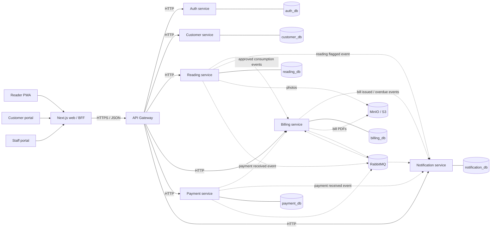

# AquaFlow architecture overview

This project follows the AquaFlow development plan and resolves the key implementation decisions into a concrete baseline.

## Core domains

- Auth: identities, roles, login sessions, JWT
- Customer: customers, service accounts, meters, addresses, zones
- Reading: billing periods, route assignments, meter readings, validation
- Billing: tariffs, bill runs, bills, ledger, adjustments
- Payment: payment attempts and receipts
- Notification: templates, preferences, delivery logs

## Service ownership

Each service owns its own database.
No service directly reads another service's database.

## Recommended baseline

- Node.js LTS + TypeScript strict mode
- Next.js App Router for web UI
- Fastify for HTTP APIs
- Prisma for database schema and migrations
- PostgreSQL for persistent data
- Redis for cache, rate limiting, idempotency tracking
- RabbitMQ for async event delivery
- MinIO for object storage, Mailpit for local email
- Docker Compose for local orchestration
- Helm + kind + Argo CD for deployment

## Context map

The diagram shows the intended target boundaries. Solid arrows indicate synchronous HTTP calls.
Dashed arrows indicate planned asynchronous event delivery; the current application does not yet
include RabbitMQ, an outbox, or inbox-based consumers.

## Current implementation versus target

- The repository has initial source for the gateway and six domain services, but their stores are
  in memory; no service-owned PostgreSQL database or migrations are wired into the runtime.
- The gateway currently routes customer and auth requests only.
- The web application is an overview page, not yet the staff, customer, or reader workflows in the
  target map.
- RabbitMQ, Redis, MinIO, Mailpit, event outbox/inbox processing, and GitOps are target components,
  not currently running infrastructure.
- See `implementation-roadmap.md` for milestone-by-milestone status and gates.
